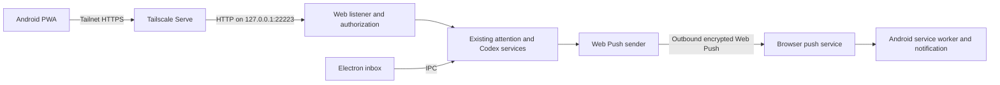

# Attention PWA over Tailscale

Status: implemented on `feat/attention-pwa`, 2026-10-24. Target confirmed by the
human: Android, including notifications while the app is closed. Initial browser
target: Firefox Android, with Chrome Android also supported. The sections below
retain the design rationale; current validation results are recorded here.

## Implementation and validation

- Added a separate browser bundle, shared inbox capabilities, HTTPS proxy
  authorization, SSE, durable request receipts, and shared answer/message actions.
- Added install metadata, maskable icons, a service worker/offline screen, and
  Firefox/Chrome Android Web Push with persistent VAPID keys and per-device subscriptions.
- Added explicit delivery reconciliation; a lost acknowledgement never causes an
  automatic replay. Confirmed receipts update the mounted card without discarding
  unrelated drafts. New user confirmation is required to abandon unknown delivery.
- Publication validation: all 321 tests across 45 suites passed. No pre-existing
  test files were modified.
- TypeScript check and production bundles passed. Isolated browser smoke passed
  without Electron preload: narrow layout, partial answers, SSE draft retention,
  message delivery, truncated acknowledgement recovery, uncertain-send deduplication,
  worker installation, Done-card deep links, and offline fallback with the proxy
  actually stopped. Existing Electron inbox smoke also passed.
- Browser screenshot inspected at 412 x 900. The smoke retains screenshots and
  a JSON result in its reported temporary evidence directory.
- Configured a local deployment for the device owner's Tailscale login on port
  22223. Restarted the desktop app with explicit human approval and verified
  private HTTPS access through Tailscale Serve. Machine configuration stays local.
- Live HTTPS page/session/snapshot checks passed. Verified the backend binds only
  `127.0.0.1`; direct requests and foreign-Origin requests return 403. Serve removes
  client-supplied identity headers and injects the authenticated user's identity.
- Push event handling is tested with fixtures. Real Android acceptance is separate
  from automated checks; the human reported that phone notifications work.
  Closed-app/locked-screen delivery was not independently observed.
- Firefox follow-up: removed the FCM-only restriction, added Mozilla's exact
  production push host while preserving endpoint URLs, and replaced Chrome-only
  UI/setup instructions. Twenty focused tests passed, including encrypted VAPID
  request generation for Firefox, endpoint rejection, persistence, and existing
  FCM/API coverage. TypeScript/build and Chromium browser smoke passed again.
- The human subsequently reported that phone notifications work. Header follow-up:
  connection state is a red/green dot beside the three-dot menu. The menu contains
  Refresh and Phone notifications, which opens a dialog. Build/typecheck, seven focused
  tests, existing PWA smoke, and live 320/344px layout/menu/offline checks passed;
  dropdown and dialog screenshots were visually inspected. Existing tests unchanged.
- The implementation is prepared for publication on `feat/attention-pwa`.
  Unrelated machine-specific debug configuration is excluded.

## Recommended architecture

Reuse the existing attention cards and services. Add a browser entry point and
HTTP implementation of AttentionBridge, hosted by the running desktop app on a
dedicated loopback listener. Tailscale Serve supplies private HTTPS access.



Phone interactions require Tailscale and an awake desktop running Tray Platform.
Codex replies also require the existing local conversation owner to be available.
Push delivery uses the browser's internet push service; it is not a tailnet-only
transport. The application itself needs no public inbound endpoint. The push
payload must be sufficient to display a notification without fetching the private
API; tapping it opens the PWA and then requires Tailscale. Delivery timing remains
subject to Android/browser notification settings and network availability.

## Current implementation and gaps

- `src/app/attention-ui.ts` already consumes the `AttentionBridge` interface in
  `src/shared/attention.ts`. Cards, state controls, questions, and composers can
  be shared between Electron and the browser.
- `src/app/renderer.ts` assumes `window.ipcComms` and initializes native titlebar,
  navigation, soundboard, bookmarks, and instance views. Serve a separate inbox
  entry point instead of loading this renderer in a browser.
- `src/main/preload_js.js` implements the bridge with Electron IPC.
- `src/main/attention-api.ts` supports listing/upserting items and changing state,
  but rejects non-loopback sockets and requests carrying an Origin header.
  Question retrieval, answers, and free-form messages currently use IPC only.
- `src/main/main.ts` owns IPC handlers, question completion behavior, and server
  lifecycle. Extract shared operations while retaining the existing IPC sender
  checks; add explicit authorization at the new web boundary.
- `src/main/attention-service.ts` already provides `onChanged` snapshots suitable
  for a live browser subscription.
- `src/main/webserver.ts` serves legacy sound/speech GET routes and JSON APIs,
  not a web application. It calls `listen(port)` without a host; the API's
  loopback restriction is an application check, not a loopback-only listener.
- Existing CSS has narrow-screen rules, but still assumes desktop titlebar
  spacing and small input text. There is no viewport metadata, manifest, service
  worker, or browser bundle.
- Live local check: Tailscale 1.102.2 is running and online. `tailscale serve
  status` reports no configuration. HTTPS consent and tailnet access policy have
  not been verified. The phone connection has not been tested.

## Implementation work

### 1. Browser UI and shared operations

Add `src/web/index.html`, a browser entry point, and `web-attention-bridge.ts`.
Mount the existing inbox with phone capabilities, without native window chrome.
Extend the build to package the web assets with the desktop application.

Expose capability information so desktop-only controls can be omitted cleanly.
The initial phone UI supports Pending/Snoozed/Done, Done/Reopen/Snooze, async
question answers, and new instructions. Preserve partial-answer handling and
drafts across incoming snapshots. Keep the current limitation that blocking
questions must be answered through their existing supported interface.

Use a shared operation layer for IPC and HTTP so answering the last question
marks the item Done identically in both clients. Continue verifying item/session
identity on the desktop; the phone supplies an item ID, not arbitrary transcript
paths, pipe commands, or a replacement session identity.

### 2. Dedicated web listener and authorization

Add an opt-in listener explicitly bound to `127.0.0.1`, with a configurable port
(proposed default 22223). Serve only packaged web assets and the intended web API.
Keep the hook API on 22222 with its existing contract. Do not proxy 22222 through
Serve: the proxy would appear as a loopback caller to its current checks.

Authorize the web API and event stream using Serve's `Tailscale-User-Login` header
and an explicit allowed-user configuration. Require the loopback proxy boundary,
reject missing/disallowed identities, and fail closed for tagged clients lacking
user identity. Local processes on the desktop remain inside this trust boundary.
Apply tailnet access rules to the served HTTPS port as an additional boundary.

Validate the configured external host/origin, require same-origin JSON writes
with CSRF protection, and do not enable wildcard CORS. Protect all read/write
routes, including subscriptions and events. Serve assets from a fixed packaged
directory with appropriate MIME types, CSP, and traversal protection.

Suggested web routes, scoped to this dedicated listener:

| Route | Purpose |
| --- | --- |
| `GET /api/attention` | Current snapshot |
| `GET /api/events` | Server-sent events, initial snapshot and subsequent changes |
| `POST /api/attention/:source/:id/state` | Done, snooze, reopen |
| `GET /api/attention/:source/:id/questions` | Verified async questions |
| `POST /api/attention/:source/:id/answers` | Submit answers and return receipt |
| `POST /api/attention/:source/:id/messages` | Send instruction and return receipt |
| `GET /api/requests/:requestId` | Reconcile a submission after connection loss |
| `GET /api/push/public-key` | Public VAPID key |
| `POST /api/push/subscriptions` | Register or refresh this device subscription |
| `POST /api/push/unsubscribe` | Disable this device subscription |

### 3. Reconnection and delivery semantics

Use fetch for operations and SSE for foreground updates. Reconnect with backoff,
send a fresh snapshot on connection, refresh on foreground/network recovery,
and show whether displayed data is stale. Clean up disconnected subscribers.

Give answer/message submissions a request ID and retain bounded durable receipts
server-side. A repeated request ID must not resend a message. After a disconnect,
query its receipt; distinguish confirmed success, confirmed rejection, and an
unknown outcome. A crash during delivery cannot establish exactly-once delivery:
show uncertainty and require reconciliation rather than replaying automatically.
Do not queue instructions for automatic submission when connectivity returns.

### 4. PWA installation and mobile layout

Add viewport and theme metadata, manifest with stable ID/start URL/scope,
standalone display, and suitable 192/512 icons including a maskable variant.
Reuse the existing visual identity. Add comfortable touch targets, phone spacing,
input sizing, keyboard handling, and scroll behavior for long questions.

Register a service worker for push and a minimal cached shell/offline screen.
Keep API responses, question contents, and message writes out of its cache.
Use versioned shell assets and an update flow that preserves an active draft.
Offline means readable connection status and disabled writes, not an apparent
successful action. HTTPS plus the manifest provide installability; the service
worker is additionally needed here for push and the offline shell.

### 5. Android background notifications

Add an explicit Enable notifications action that requests permission and creates
a PushSubscription. Persist subscriptions and a stable VAPID key pair on the
desktop; only expose the public key. Use a maintained Web Push implementation
compatible with the project's supported Node/Electron runtime.

Trigger pushes on newly pending items and snooze expiry. Persist notification
event identities so app restarts and repeated hook writes do not replay old
notifications. Coalesce events by attention item, use bounded expiry/retries,
stop sending expired/resolved queued alerts, and retire invalid subscriptions.
Push failures must not block the attention store or Electron notifications.

The worker handles `push` and `notificationclick`, displays a notification with
an item-specific tag, and opens/focuses the matching card. Start with project and
item title in notifications; keep full question text and replies in the pane.
Provide per-device disable and a test notification action. Test reconnecting and
subscription recovery without creating duplicate device subscriptions.

### 6. Tailscale setup and lifecycle

After the authorized web listener exists, enable HTTPS certificates if needed,
check tailnet access rules, then configure Serve to proxy the dedicated port:

```powershell
tailscale serve --bg --https=443 http://127.0.0.1:22223
```

This command was executed after implementation and validation. It creates
persistent tailnet HTTPS access. Check existing Serve configuration again before
applying it. Use the resulting `https://<desktop>.<tailnet>.ts.net` URL in Android
Firefox or Chrome and install the PWA. Use Serve's private sharing mode for this app.

Keep the web listener, SSE connections, and push sender tied to desktop app
startup/shutdown. Document the awake/logged-in desktop requirement and startup
settings. A headless Windows service is a separate project because the current
Codex delivery and native navigation depend on the interactive user session.

## Validation and delivery order

1. Shared operations, authenticated web API, browser bridge, and foreground inbox.
2. Mobile layout, manifest/service worker, private HTTPS, Android installation.
3. Push subscriptions, sender, event deduplication, and notification navigation.
4. Full local suite/build plus isolated Electron regression smoke. Add new tests
   for authorization, origin/CSRF handling, API parity, reconnect/receipt behavior,
   and push lifecycle. Ask before editing any pre-existing tests.
5. Browser smoke with fixture Codex services: no Electron globals, state sync in
   both directions, partial questions, draft retention, unknown delivery, offline
   state, service worker update, and no duplicate submissions.
6. Real Android acceptance over cellular + Tailscale: install, answer a fixture
   question, send a fixture instruction, receive a notification while the PWA is
   closed/screen locked, tap into the right card, snooze, reconnect, and restart
   the desktop app. Verify unauthorized tailnet access is denied and the new
   backend port cannot be reached directly over LAN/tailnet.

## Scope assessment

This is a moderate feature: most UI and business behavior already exist. The
substantial new work is web authorization, reliable submissions across mobile
disconnects, and background push. A second UI framework, hosted cloud backend,
and a native Android app are unnecessary for this design.

# HUMAN QUESTIONS

- Resolved: Android is the target.
- Resolved: the human uses Firefox Android; Mozilla's production push endpoint
  is allowed alongside FCM, and setup instructions are browser-neutral.
- Resolved: notifications while the app is closed are required.
- Phone Go behavior: recommend hiding Windows-window Go initially; optionally
  add an explicitly named Focus desktop action later. URL destinations can open
  on the phone. This does not provide remote desktop viewing.
- Notification content/frequency: proposed default is project + title for new
  pending items and snooze expiry. Full question text stays in the pane; filters
  or generic lock-screen text can be added if preferred.
- Resolved deployment values: use the current device owner's Tailscale login
  and Serve HTTPS origin; configured and verified locally.

## Sources checked

- [Tailscale Serve: private sharing, access policy, and identity headers](https://tailscale.com/docs/features/tailscale-serve)
- [Tailscale Serve CLI and persistent background configuration](https://tailscale.com/docs/reference/tailscale-cli/serve)
- [MDN: PWA installability](https://developer.mozilla.org/en-US/docs/Web/Progressive_web_apps/Guides/Making_PWAs_installable)
- [Google: Web Push architecture and encrypted subscription delivery](https://web.dev/articles/push-notifications-overview)
- [MDN: Push API and service worker delivery](https://developer.mozilla.org/en-US/docs/Web/API/Push_API)
